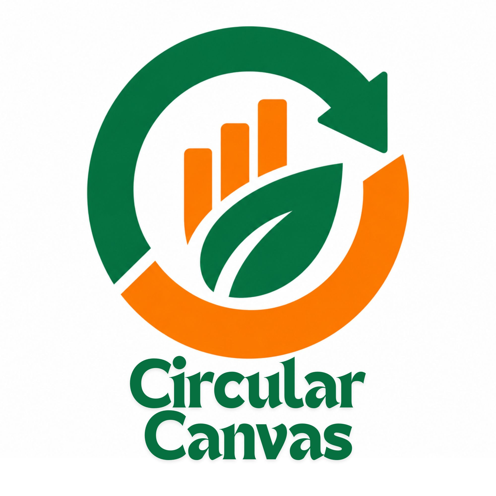
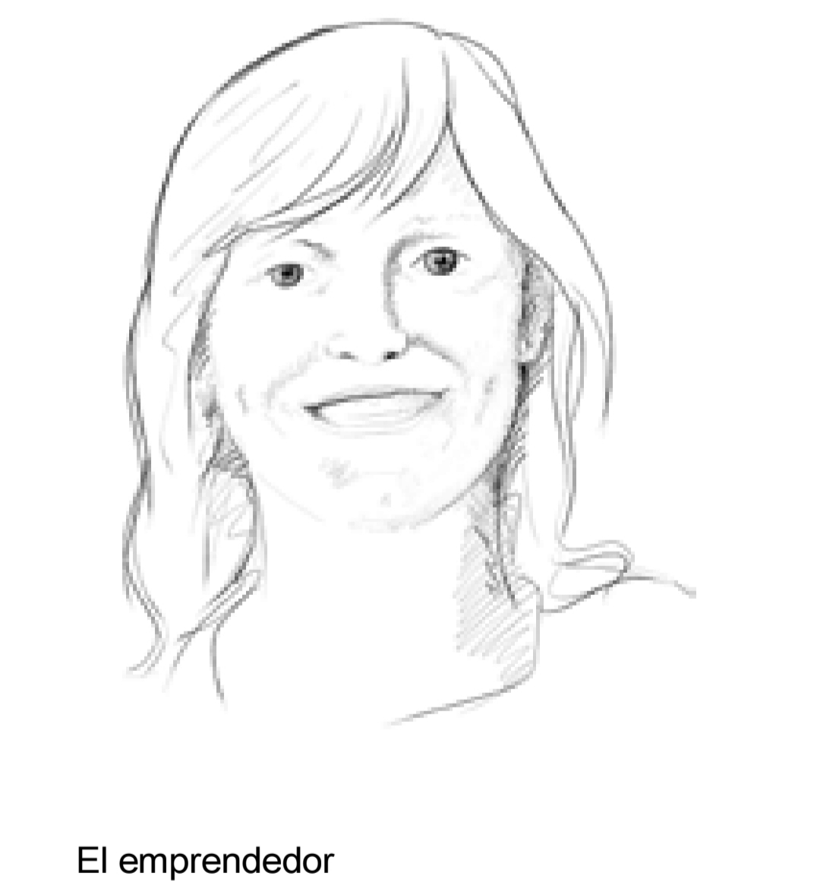
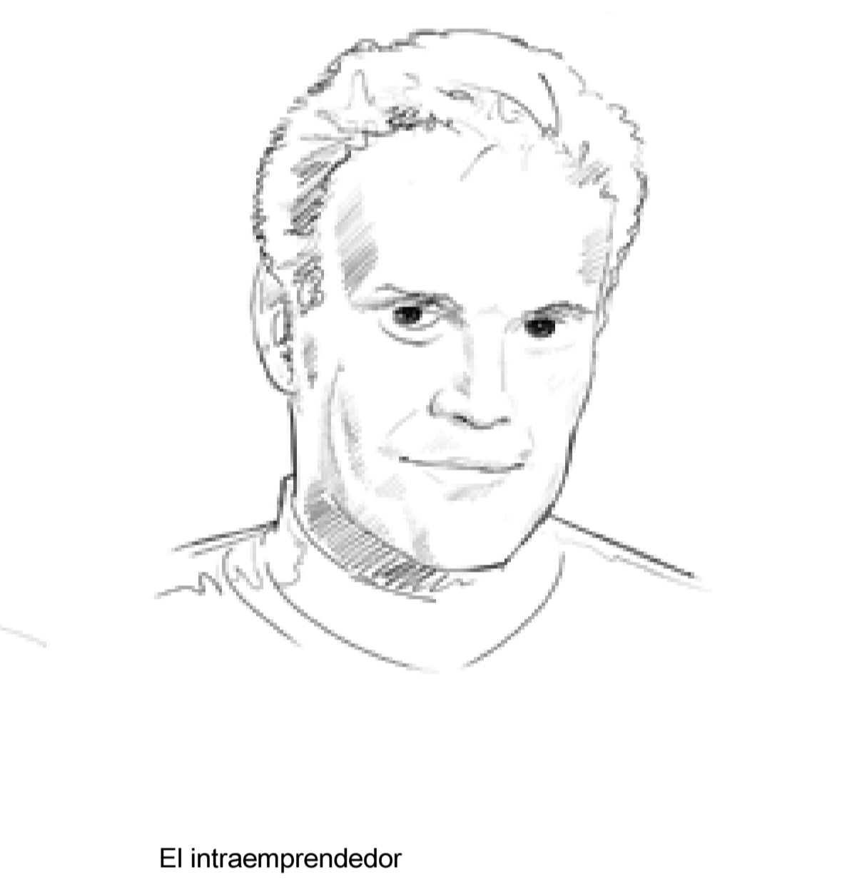
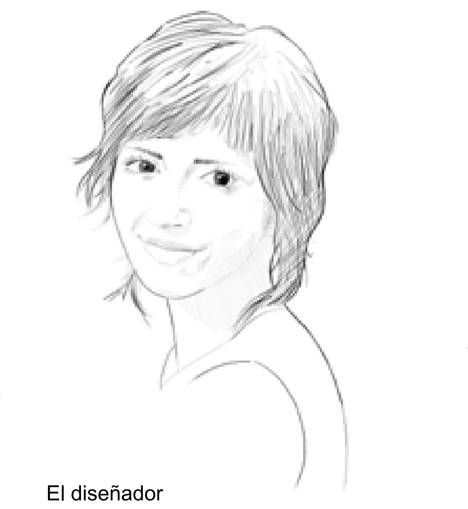
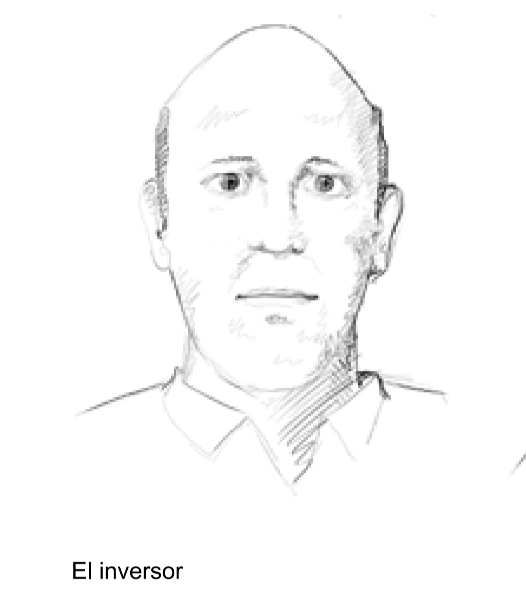

# ♻️ CircularCanvas

<p align="center">
  
</p>

<h3 align="center">Sistema de evaluación de factibilidad de modelos de negocio con enfoque en economía circular</h3>

<p align="center">
  Una herramienta para diseñar, analizar y evaluar modelos de negocio sostenibles mediante el Business Model Canvas y criterios de economía circular.
</p>

<p align="center">
  
  
  
  
  
</p>

---

## 📖 Descripción

**CircularCanvas** es una aplicación desarrollada con Flutter que permite construir, analizar y evaluar la factibilidad de modelos de negocio, incorporando principios de economía circular y sostenibilidad.

La aplicación integra el **Business Model Canvas (BMC)** con una extensión de **Canvas de Modelo de Negocio Circular (CBMC)**, una evaluación ponderada de factibilidad y un análisis estratégico DAFO.

El sistema permite que el usuario defina su modelo de negocio desde diferentes perspectivas de innovación, complete los bloques del Canvas, evalúe afirmaciones relacionadas con su viabilidad y obtenga resultados que faciliten la identificación de fortalezas, debilidades, oportunidades y amenazas.

## 🎯 Objetivo del proyecto

Desarrollar una herramienta digital que facilite el diseño y la evaluación de modelos de negocio, considerando tanto su viabilidad como la incorporación de estrategias de economía circular.

### Objetivos específicos

- Facilitar la estructuración de ideas de negocio mediante el Business Model Canvas.
- Incorporar criterios de sostenibilidad y economía circular.
- Evaluar la factibilidad mediante puntuaciones e indicadores de importancia.
- Identificar fortalezas y debilidades a partir de los resultados obtenidos.
- Complementar el análisis con observaciones estratégicas DAFO.
- Conservar las evaluaciones para su consulta, edición y seguimiento.
- Generar reportes en PDF para documentar los resultados.

---

## ✨ Características principales

### 1. Las 7 caras de la innovación

La aplicación permite iniciar una evaluación seleccionando una de las siete perspectivas de innovación en modelos de negocio.

| Perspectiva | Enfoque |
|---|---|
| Director ejecutivo | Visión global y sostenibilidad del modelo. |
| Intrapreneur | Innovación desde dentro de una empresa. |
| Emprendedor | Creación de un negocio desde cero. |
| Inversor | Viabilidad financiera y fuentes de ingreso. |
| Consultor | Diagnóstico externo del modelo. |
| Diseñador | Propuesta de valor y experiencia del cliente. |
| Emprendedor concienciado | Impacto ambiental y circularidad. |

Cada perspectiva permite analizar el modelo de negocio desde un enfoque diferente.

### 2. Business Model Canvas circular

Incluye una representación visual e interactiva de **11 bloques**. El usuario puede seleccionar cada bloque, consultar su descripción y pregunta guía, y registrar la información correspondiente a su modelo de negocio.

Los nueve bloques tradicionales del Business Model Canvas se complementan con dos bloques orientados a la economía circular.

Los bloques se organizan en:

- Segmentos de clientes.
- Propuesta de valor.
- Canales.
- Relaciones con clientes.
- Fuentes de ingresos.
- Recursos clave.
- Actividades clave.
- Socios clave.
- Estructura de costos.
- Extensión de economía circular.
- Estrategias de circularidad.

La interfaz incluye un indicador de progreso para visualizar cuántos bloques han sido completados.

### 3. Evaluación de factibilidad

Permite evaluar diferentes afirmaciones relacionadas con el modelo de negocio mediante controles deslizantes.

Cada criterio considera dos variables:

- **Puntuación:** nivel de cumplimiento o acuerdo, en una escala del 1 al 5.
- **Importancia:** relevancia del criterio para el modelo, en una escala del 1 al 10.

Las respuestas se utilizan para calcular un índice de factibilidad ponderado.

### 4. Resultados e indicadores

Al finalizar la evaluación, el sistema calcula un índice porcentual y presenta una clasificación:

| Índice de factibilidad | Clasificación |
|---|---|
| 70 % – 100 % | Alta |
| 40 % – 69 % | Media |
| 0 % – 39 % | Baja |

También permite visualizar los resultados por bloque y reconocer áreas que requieren atención.

### 5. Análisis estratégico DAFO

La aplicación incorpora un análisis DAFO para complementar los resultados de factibilidad.

Incluye cuatro dimensiones:

- **Fortalezas:** aspectos internos favorables del modelo.
- **Debilidades:** aspectos internos que requieren mejoras.
- **Oportunidades:** factores externos que pueden favorecer el negocio.
- **Amenazas:** factores externos que pueden representar riesgos.

El sistema identifica fortalezas y debilidades a partir de los resultados de evaluación. Además, permite incorporar observaciones manuales en los cuatro cuadrantes.

También presenta la información registrada en los bloques del Canvas como referencia para fundamentar el análisis.

### 6. Historial de evaluaciones

Las evaluaciones pueden guardarse localmente para consultarlas posteriormente.

El historial permite:

- Consultar evaluaciones anteriores.
- Visualizar el índice y nivel de factibilidad.
- Identificar la fecha de cada evaluación.
- Consultar el avance de los bloques del Canvas.
- Editar evaluaciones guardadas.
- Eliminar evaluaciones.

Al editar una evaluación, se recupera la información registrada previamente para continuar trabajando sobre ella.

### 7. Gestión de archivos adjuntos

Cada evaluación puede complementarse con archivos de referencia.

El sistema permite:

- Adjuntar archivos a una evaluación.
- Consultar los archivos asociados.
- Descargar archivos adjuntos.
- Eliminar archivos.
- Mantener los archivos relacionados con su evaluación correspondiente.

### 8. Exportación de reportes PDF

La aplicación permite generar un documento PDF con los resultados del análisis.

El reporte incorpora información del modelo de negocio, indicadores de factibilidad y análisis DAFO, incluyendo las observaciones registradas.

---

## 🖼️ Galería de imágenes

### Identidad del proyecto

<p align="center">
  
</p>

### Perspectivas de innovación

<table>
  <tr>
    <td align="center">
      
      <br><strong>Emprendedor</strong>
    </td>
    <td align="center">
      
      <br><strong>Intrapreneur</strong>
    </td>
    <td align="center">
      
      <br><strong>Consultor</strong>
    </td>
  </tr>
  <tr>
    <td align="center">
      
      <br><strong>Diseñador</strong>
    </td>
    <td align="center">
      
      <br><strong>Inversor</strong>
    </td>
    <td align="center">
      
      <br><strong>Senior</strong>
    </td>
  </tr>
  <tr>
    <td align="center">
      
      <br><strong>Concienciado</strong>
    </td>
  </tr>
</table>

---

## 🛠️ Tecnologías utilizadas

El proyecto está desarrollado utilizando las siguientes tecnologías y paquetes:

| Tecnología | Uso |
|---|---|
| [Flutter](https://flutter.dev/) | Framework para el desarrollo de la aplicación. |
| [Dart](https://dart.dev/) | Lenguaje de programación. |
| [Hive](https://pub.dev/packages/hive) | Persistencia local de información. |
| [Hive Flutter](https://pub.dev/packages/hive_flutter) | Integración de Hive con Flutter. |
| [FL Chart](https://pub.dev/packages/fl_chart) | Visualización de gráficos. |
| [Google Fonts](https://pub.dev/packages/google_fonts) | Tipografías. |
| [UUID](https://pub.dev/packages/uuid) | Identificadores únicos para las evaluaciones. |
| [PDF](https://pub.dev/packages/pdf) | Generación de documentos PDF. |
| [Printing](https://pub.dev/packages/printing) | Presentación e impresión de documentos PDF. |
| [Image](https://pub.dev/packages/image) | Procesamiento de imágenes. |
| [Archive](https://pub.dev/packages/archive) | Manejo de archivos comprimidos. |
| [File Picker](https://pub.dev/packages/file_picker) | Selección de archivos para adjuntar. |

---

## 🏗️ Estructura del proyecto

La organización principal del código fuente es la siguiente:

```text
CircularCanvas/
│
├── assets/
│   └── images/
│       ├── logo_circular_canvas.jpg
│       ├── concienzudo.jpg
│       ├── consultor.jpg
│       ├── disenador.jpg
│       ├── emprendedor.jpg
│       ├── intraemprendedor.jpg
│       ├── inversor.jpg
│       └── senior.jpg
│
├── lib/
│   ├── data/
│   │   ├── adjunto_service.dart
│   │   ├── canvas_data.dart
│   │   ├── db_service.dart
│   │   └── tema.dart
│   │
│   ├── models/
│   │   └── models.dart
│   │
│   ├── screens/
│   │   ├── pantalla_rol.dart
│   │   ├── pantalla_canvas.dart
│   │   ├── pantalla_evaluacion.dart
│   │   ├── pantalla_resultados.dart
│   │   └── pantalla_historial.dart
│   │
│   ├── services/
│   │   └── pdf_service.dart
│   │
│   ├── widgets/
│   │   └── tarjeta_bloque.dart
│   │
│   └── main.dart
│
├── test/
├── web/
├── android/
├── ios/
├── windows/
├── linux/
├── macos/
│
├── pubspec.yaml
├── pubspec.lock
├── analysis_options.yaml
├── .gitignore
└── README.md
```

### Descripción de los directorios

- **assets/images:** recursos gráficos, logotipo e imágenes de las perspectivas de innovación.
- **lib/data:** datos del Canvas, configuración visual, persistencia y gestión de archivos.
- **lib/models:** modelos de datos y estructuras utilizadas por la aplicación.
- **lib/screens:** pantallas y flujo principal de navegación.
- **lib/services:** servicios para la generación de documentos PDF.
- **lib/widgets:** componentes reutilizables de interfaz.
- **test:** espacio destinado a las pruebas del proyecto.

---

## ⚙️ Instalación y configuración

### Requisitos previos

Antes de ejecutar el proyecto, asegúrate de contar con:

- [Flutter SDK](https://docs.flutter.dev/get-started/install) instalado.
- Dart SDK (incluido con Flutter).
- [Git](https://git-scm.com/) instalado.
- Un editor de código como [Visual Studio Code](https://code.visualstudio.com/) o Android Studio.
- Google Chrome para ejecutar la versión web.

### 1. Clonar el repositorio

Abre una terminal y ejecuta:

```bash
git clone https://github.com/OmarGR203/CircularCanvas.git
```

### 2. Acceder al directorio

```bash
cd CircularCanvas
```

### 3. Instalar las dependencias

```bash
flutter pub get
```

### 4. Verificar el entorno de Flutter

```bash
flutter doctor
```

### 5. Ejecutar el análisis estático

```bash
flutter analyze
```

### 6. Ejecutar la aplicación en Chrome

```bash
flutter run -d chrome
```

---

## 💾 Almacenamiento de información

CircularCanvas utiliza **Hive** como mecanismo de persistencia local.

Se manejan cajas de almacenamiento para:

| Caja | Información |
|---|---|
| `sesiones` | Evaluaciones, datos del negocio, bloques Canvas, puntuaciones e importancias. |
| `adjuntos` | Archivos relacionados con las evaluaciones. |
| `analisis_dafo` | Observaciones registradas en los cuadrantes DAFO. |

La información se conserva localmente en el entorno de ejecución compatible con Hive. En la versión web, el almacenamiento del navegador se apoya en IndexedDB.

> **Nota:** La persistencia es local. Actualmente, el proyecto no implementa sincronización entre usuarios ni una base de datos centralizada en la nube.

---

## 📊 Fundamentos metodológicos

El desarrollo de CircularCanvas toma como referencia los siguientes enfoques:

- **Business Model Canvas:** herramienta para diseñar y estructurar modelos de negocio.
- **Circular Business Model Canvas (CBMC):** extensión del Canvas tradicional que incorpora estrategias y criterios de economía circular.
- **Evaluación ponderada:** cálculo de factibilidad considerando puntuación e importancia de los criterios.
- **Análisis DAFO:** identificación de fortalezas, debilidades, oportunidades y amenazas.

### Referencias bibliográficas

- Lewandowski, M. (2015). *Designing the Business Models for Circular Economy—Towards the Conceptual Framework*. Sustainability, 7(1), 43–60. https://doi.org/10.3390/su7010043
- Osterwalder, A., & Pigneur, Y. (2010). *Business Model Generation: A Handbook for Visionaries, Game Changers, and Challengers*. John Wiley & Sons.

---

## 🚀 Estado del proyecto

CircularCanvas se encuentra en desarrollo.

Las funcionalidades implementadas incluyen:

- [x] Selección de las siete perspectivas de innovación.
- [x] Construcción del Canvas de modelo de negocio.
- [x] Extensión del Canvas con criterios de economía circular.
- [x] Evaluación ponderada de factibilidad.
- [x] Cálculo del índice de factibilidad.
- [x] Visualización de resultados por bloque.
- [x] Análisis DAFO con observaciones editables.
- [x] Consulta de información del Canvas desde resultados.
- [x] Guardado y recuperación de evaluaciones.
- [x] Edición y eliminación de evaluaciones.
- [x] Gestión de archivos adjuntos.
- [x] Exportación de reportes PDF.

---


## 👨‍💻 Autor

**Omar Guzmán Rafael**

Proyecto académico enfocado en la evaluación de modelos de negocio y economía circular.

- GitHub: [@OmarGR203](https://github.com/OmarGR203)
- Repositorio: [CircularCanvas](https://github.com/OmarGR203/CircularCanvas)


<p align="center">
  <strong>♻️ CircularCanvas — Diseña, evalúa e impulsa modelos de negocio sostenibles.</strong>
</p>
